# GIGABYTE-EP45-UD3-Install-Hackintosh-Mac-OS-X-Tiger-to-Mac-OS-X-Lion-and-Windows-2000

> 继 https://github.com/bugprogrammer/ASUS-p8z77m-pro-Install-Hackintosh-OS-X-Mountain-Lion-to-macOS-Sequoia-and-WindowsXP-to-Windows11 项目之后，笔者在一台技嘉 EP45-UD3+Intel Core 2 Quad Q9550+Nvidia Quadra FX 4500+8G DDR2 800mhz RAM 计算机上安装了 Mac OS X Tiger-Mac OS X Lion 以及 Windows 2000 操作系统，至此，笔者在 P45 以及 Z77 两台计算机上集齐了包括 Windows 2000-Windows 11 的所有 Windows 操作系统版本以及所有 Intel Mac OS X/OS X/macOS 操作系统版本。

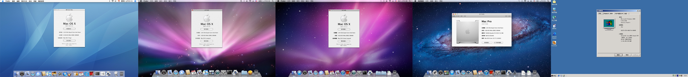

- [配置清单](#配置清单)
- [为何选择这套配置](#为何选择这套配置)
  - [主板 + CPU](#主板--cpu)
  - [显卡](#显卡)
  - [无线网卡 + 蓝牙](#无线网卡--蓝牙)
  - [显示器](#显示器)
- [黑苹果完美程度](#黑苹果完美程度)
  - [正常工作](#正常工作)
  - [Bug](#bug)
- [构建重点](#构建重点)
  - [BIOS 设置](#bios-设置)
    - [Standard CMOS Features](#standard-cmos-features)
    - [Advanced CMOS Features](#advanced-cmos-features)
    - [Integrated Peripherals](#integrated-peripherals)
    - [Power Management Setup](#power-management-setup)
  - [Bootloader 选择](#bootloader-选择)
    - [OpenCore+OpenDuet 用于引导 Mac OS X Tiger-Mac OS X Lion 以及 grub4dos](#opencoreopenduet-用于引导-mac-os-x-tiger-mac-os-x-lion-以及-grub4dos)
    - [grub4dos 用于引导 Windows 2000](#grub4dos-用于引导-windows-2000)
  - [NVRAM 模拟](#nvram-模拟)
  - [SMBIOS (重中之重)](#smbios-重中之重)
    - [选择](#选择)
    - [内存识别修复](#内存识别修复)
  - [时间同步](#时间同步)
  - [独显驱动](#独显驱动)
  - [显示器被识别为电视](#显示器被识别为电视)
  - [声卡驱动](#声卡驱动)
  - [以太网卡](#以太网卡)
    - [10.4](#104)
    - [10.5/10.6](#105106)
    - [10.7](#107)
  - [WIFI](#wifi)
    - [10.4](#104-1)
    - [10.5-10.7](#105-107)
  - [蓝牙](#蓝牙)
  - [USB](#usb)
    - [10.4](#104-2)
      - [EHCI](#ehci)
      - [UHCI](#uhci)
    - [10.5-10.7](#105-107-1)
  - [睡眠唤醒](#睡眠唤醒)
    - [10.4](#104-3)
      - [睡眠](#睡眠)
      - [唤醒](#唤醒)
    - [10.5-10.7](#105-107-2)
  - [EC 修复](#ec-修复)
  - [每次重启 / 关机时都会重置 BIOS](#每次重启--关机时都会重置-bios)
  - [内置硬盘显示为外置](#内置硬盘显示为外置)
  - [10.6/10.7 下开启 SSD Trim](#106107-下开启-ssd-trim)
  - [重启不断电](#重启不断电)
    - [10.4](#104-4)
    - [10.5-10.7](#105-107-3)
    - [AppleLPC 加载](#applelpc-加载)
  - [SATA 控制器重命名](#sata-控制器重命名)
  - [Tiger 下不显示二级缓存信息](#tiger-下不显示二级缓存信息)
  - [Lion 下关于本机不显示年份信息](#lion-下关于本机不显示年份信息)
    - [确定原生年份信息](#确定原生年份信息)
      - [Mac Pro 1,1 和 Mac Pro 2,1](#mac-pro-11-和-mac-pro-21)
      - [其他机型](#其他机型)
- [引导器截图](#引导器截图)
  - [OpenCore (请允许我使用 AI 制作 4K OC Menu 图，OpenDuet 环境下 F10 截图，效果实在太差了)](#opencore-请允许我使用-ai-制作-4k-oc-menu-图openduet-环境下-f10-截图效果实在太差了)
- [系统桌面截图](#系统桌面截图)


# 配置清单

- 主板： 技嘉 EP45-UD3

- CPU： Intel Core 2 Quad Q9550

- 内存： 8G DDR2 800mhz

- 显卡： Nvidia Quadra FX 4500

- SSD1：阿斯加特 SATA 240g

- SSD2：威刚 SP600 SATA 60g

- 无线网卡：BCM94321MC

- 蓝牙：CSR8510 USB 蓝牙

- 显示器：阿卓帕 13.3 寸 1080P 便携屏

- 机箱：乔思伯 D41

- 操作系统：Windows 2000

- 操作系统：Mac OS X Tiger-Mac OS X Lion

# 为何选择这套配置

## 主板 + CPU

> 原生支持 Mac OS X Tiger-Mac OS X Lion 的平台是 Intel Core 2 时代的平台，笔者选择了 P45，而技嘉的 P45，拥有一个第三方的 SATA (JMicron JMB363，技嘉称之为 GSATA)，这个 GSATA 拥有原生的 Windows 2000 AHCI 驱动，所以笔者选择了技嘉 EP45-UD3+Intel Core 2 Quad Q9550。Intel AHCI 安装 Mac OS X，技嘉的 GSATA 安装 Windows 2000。如此一来 BIOS 里可以完美开启双 AHCI。

## 显卡

> 根据 Dortania 的 OpenCore 文档，以及 Mac Pro 初代的可选显卡列表可知，支持 Mac OS X Tiger-Mac OS X Lion 的旗舰卡是 Nvidia Quadra FX 4500 以及 ATI Radeon X1900 XT，后者笔者没有把握驱动成功，所以选择了 Nvidia Quadra FX 4500。注意，G80 核心的 Nvidia Quadra FX 5600 也可以支持 Mac OS X Tiger-Mac OS X Lion，但是 Tiger 下有个 bug。在使用 DVI-HDMI 线缆的情况下，进系统不亮屏，需要在 OC Menu 处拔掉 HDMI 线缆，等进系统以后再插上才能亮屏。用 DVI-DVI 则没有这个问题。详情如下：https://www.insanelymac.com/forum/topic/65849-geforce-8800-g80-only-easy-installer-tutorial/ 。 Nvidia Quadra FX 4500 也有完美的 Windows 2000 驱动。

## 无线网卡 + 蓝牙

> 根据网络资料得知，BCM94321MC 无线网卡 + CSR8510 USB 蓝牙，在 Mac OS X Tier-Mac OS X Lion 是原生免驱，无线网卡需要安装 PCIE 转接卡方可使用。

## 显示器

> 因为老系统没有 HIDPI 功能 (Lion 除外)，并且 DVI-HDMI 只能做到 1080P 分辨率，所以笔者放弃了大尺寸 1080P 显示器 (PPI 太低了)，按照老 Mac 的 PPI 去选择。最终笔者选择了阿卓帕 13.3 寸 1080P 便携屏。使用时开 1360x768 分辨率，相当于 117.43 ppi，显示效果远强于 27 寸 1080P/2K 显示器。

# 黑苹果完美程度

## 正常工作

- 声卡

- 独显

- 有线网卡

- WiFi

- 蓝牙

- 睡眠

- 唤醒

- USB

- 变频

## Bug

- 暂未发现

# 构建重点

> 先说重点。首先此项目笔者用 SSDT Hotatch 始终有 bug，故选择传统方案使用完整 DSDT。笔者的 DSDT 参考了 AppleBreak1 的项目。https://github.com/AppleBreak1/EP45-UD3P-Customac， 在此感谢 AppleBreak1。其次，Nvidia Quadra FX 4500 没有 64 位驱动，故必须选择搭载 32 位 EFI 的 SMBIOS，并且所有的 Kexts 必须支持 32 位。可以用如下命令确定 Kexts 是否支持 32 位。
>
> _**file xxx.kext/Contents/MacOS/xxx**_

## BIOS 设置

### Standard CMOS Features

- Drive A->None
- Floppy 3 Mode Support->Disabled

### Advanced CMOS Features

- Quick Boot->Disabled
- Init Display First->PEG

### Integrated Peripherals

- SATA AHCI Mode->AHCI
- Onboard H/W 1394->Disabled
- Onboard SATA/IDE Device->Enabled
- Onboard SATA/IDE Ctrl Mode->AHCI (先设置为 IDE，安装好 Windows 2000 并打好驱动再开 AHCI)
- Onboard Serial Port 1->Disabled
- Onboard Parallel Port->Disabled
- USB 相关选项->Enabled

### Power Management Setup

- ACPI Suspend Type->S3(STR)
- HPET Support->Enabled
- HPET Mode->64-bit mode

## Bootloader 选择

> 一个重点：OpenCore 自带的 OpenLegacyBoot.efi 用于启动 legacy+mbr 的操作系统，但是启动 NT5 有概率失败。因为这台计算机拥有两块硬盘。OpenDuet 的枚举顺序可能和 BIOS 不同，导致 NT5 系统因为 OpenDuet 传过来的 DL 号和 BIOS 枚举以及 boot.ini 的配置对不上而启动失败，借助 grub4dos 的 map 命令即可完美解决这个问题。

### OpenCore+OpenDuet 用于引导 Mac OS X Tiger-Mac OS X Lion 以及 grub4dos

- 执行 OpenCore 中的 LegacyBoot 目录下的 BootInstall\_X64.tool 脚本以安装 OpenDuet 环境
- 在 OpenCore 下加入 OpenLegacyBoot.efi 文件并启用以识别 grub4dos 条目 (请使用 OpenCore 1.0.8 版本，里面有笔者的提交以支持 grub4dos 条目识别)

### grub4dos 用于引导 Windows 2000

- 在 PE 下使用 bootice 工具将 grub4dos 的 pbr 写入 Windows 2000 分区 (bootice 自带 grub4dos 的 pbr) 以安装 grub4dos
- 拷贝 grldr 文件以及 menu.lst 文件到 Windows 2000 根目录 (仓库中已提供所需文件)
- menu.lst 文件加入如下内容
  ```
  default 0
  timeout 0

  title Windows 2000
  find --set-root /ntldr
  if not "%@root%"=="(hd0,0)" map () (hd0) && map --hook
  chainloader /ntldr
  ```

## NVRAM 模拟

> P45 是很老的平台，需要模拟 NVRAM，教程如下。

- 在 OpenCore 中添加并启用 OpenRuntime.efi 文件
- 在 OpenCore 中做如下设置
  - Booter -> Quirks
    - DisableVariableWrite: NO
      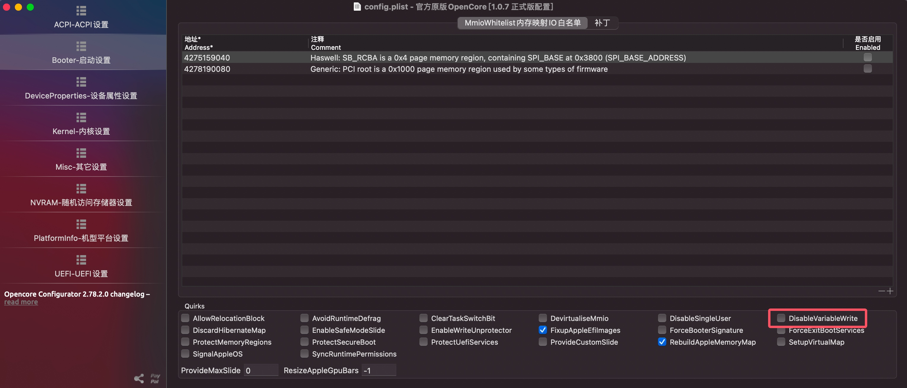
  - Misc -> Security
    - ExposeSensitiveData: 3
      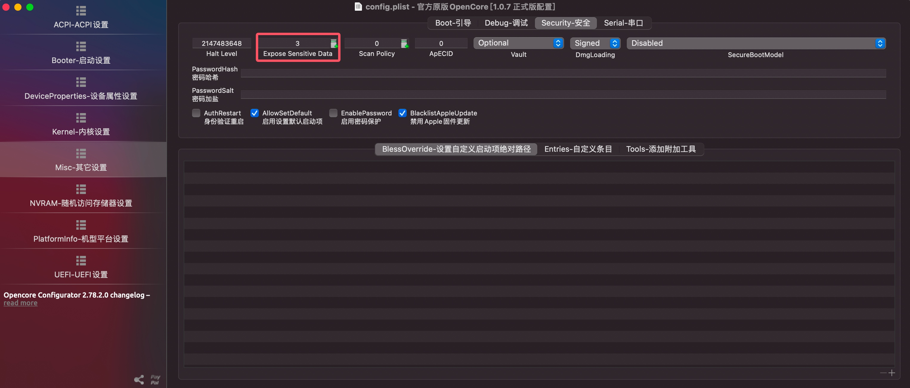
  - NVRAM
    - LegacyOverwrite: YES
      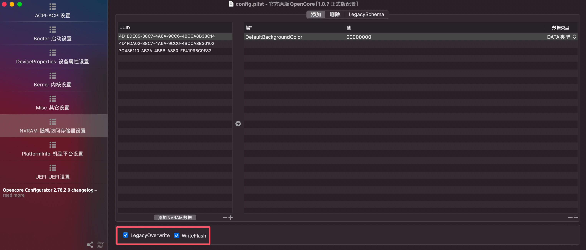
    - WriteFlash: YES
      
    - LegacySchema: 添加如图条目
      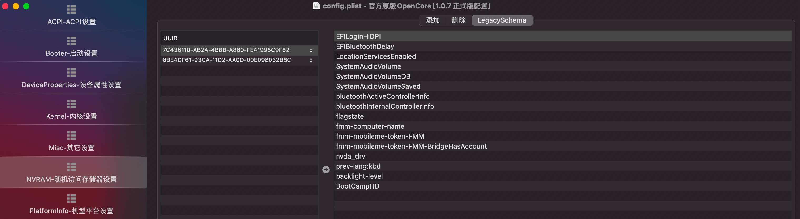
      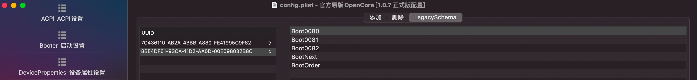
- 进入 OpenCore 的 LogoutHook 目录执行如下命令并重启
  ```
  ./Launchd.command install 
  ```

> 至此，您已成功完成 NVRAM 模拟操作。

## SMBIOS (重中之重)

### 选择

> 由于笔者的 Nvidia Quadra FX 4500 没有 64 位驱动，只支持在 32 位内核下运行，所以笔者选择的是搭载 32 位 EFI 的 SMBIOS，Mac Pro 2,1。

### 内存识别修复

> 某些情况下，内存信息不识别或识别错误，需要我们手动注入内存信息并开启自定义内存。

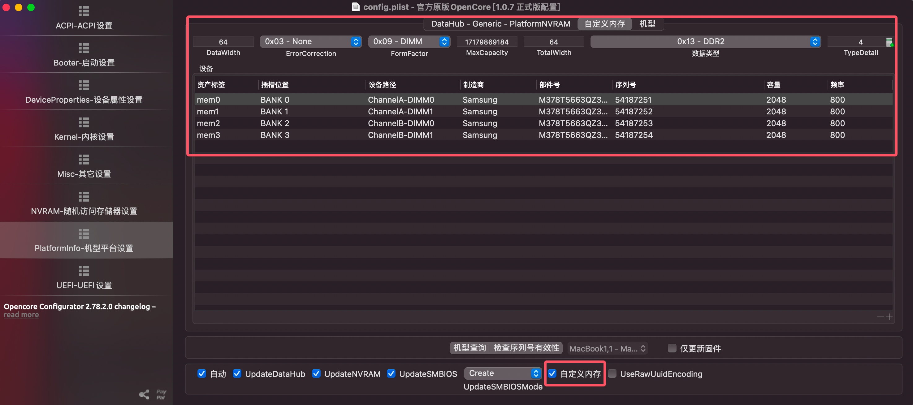

## 时间同步

- 在 Windows 下导入仓库中的 WinUTCOn.reg 文件，重启即可解决 Windows 时间不对的问题。

## 独显驱动

- 在 dos 下用 nvflash 工具刷入仓库中提供的 vbios 文件，文件名为 FX4500.ROM
  ```
  .\nvflash.exe -4 -5 -6 .\FX4500.ROM
  ```

- 在 OpenCore 下注入如下属性即可驱动显卡 (笔者屏蔽了一个 DVI 接口以避免出现幽灵屏，保留的贴近主板一侧的 DVI 接口，如需调整请修改 NVCAP)
  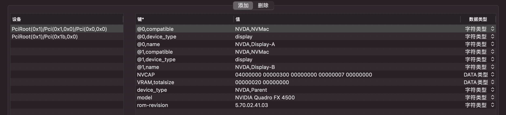

## 显示器被识别为电视

- 运行笔者仓库中 patch-edid.rb 脚本，会在当前目录生成一个文件夹，类似 DisplayVendorID-1ee4
- 把生成的文件夹拷贝到 /Library/Displays/Contents/Resources/Overrides 目录
- 重启即可修复显示器识别成电视问题
  

## 声卡驱动
- 在 OpenCore 中加入并启用 Lilu.kext 以及 AppleALC.kext
- 在 OpenCore 下注入如下属性即可驱动声卡
  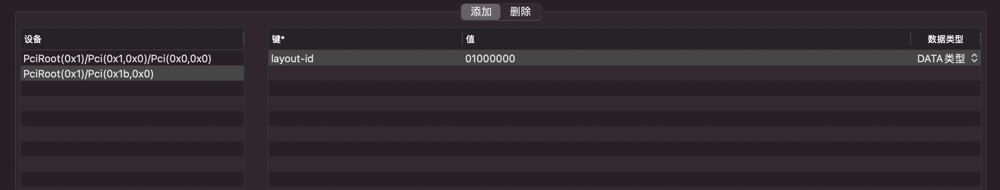
- 10.4 以及 10.5 如果安装版本低于 10.4.11 以及 10.5.8，请在线更新到 10.4.11 以及 10.5.8 版本声卡即可正常 (没错，10.4-10.7 至今还可以在线更新，包括 PowerPC 芯片的 Mac 也可以更新到最新的支持版本)

## 以太网卡

### 10.4

- 在 OpenCore 中加入并启用修改版本的 AppleRTL8169Ethernet.kext (笔者仓库已提供)，MaxKernel 设置为 8.99.99 以避免影响其他系统
  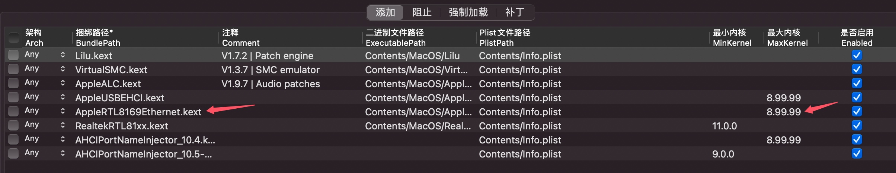
- 在 OpenCore 中设置 block 内置的 AppleRTL8169Ethernet.kext，MaxKernel 设置为 8.99.99 以避免影响其他系统
  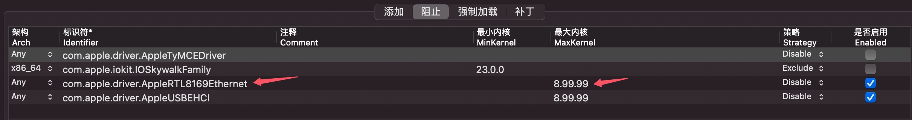

### 10.5/10.6
- 免驱

### 10.7

- 在 OpenCore 中加入并启用笔者编译的 RealtekRTL81xx.kext 并设置 MinKernel 为 11.0.0 (笔者仓库已提供，此驱动支持 1Gbps，同时支持 32 位 / 64 位，原项目链接如下：https://github.com/SergeySlice/RealtekLANv3)
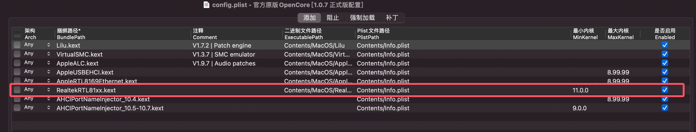  

## WIFI

### 10.4
> BCM94321MC 在 Tiger 下是免驱的，但是有一个枚举 bug，就是由于未知原因将 WIFI 识别成 en0，将以太网卡挤到 en1，具像化的表现就是 Tiger 下的系统信息里无线网卡是关闭状态，但是设置里，会显示两个以太网卡，通过查看 Mac 地址可知，无线网卡在 Tiger 下被识别成了以太网卡。下面是解决方案。
- 打开 /Library/Preferences/SystemConfiguration/NetworkInterfaces.plist 文件，按照下图修改。以太网卡: en0，IOInterfaceUnit: 0，无线网卡: en1，IOInterfaceUnit: 1
  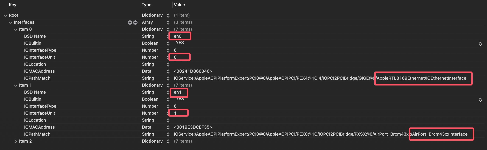
- 删除 /Library/Preferences/preferences.plist 文件
- 重启
> 至此，Tiger 下的 WIFI 以完美修复。
### 10.5-10.7
- 免驱

## 蓝牙

- Mac OS X Tiger-Mac OS X Lion 免驱
  
## USB

> 10.4 和 10.5-10.7 的 USB 修复方式完全不同，但是不会互相冲突，一个 EFI 完美兼容 4 个 Mac OS X 版本。

### 10.4
> Tiger 上的 USB 有 Bug 并且影响唤醒，笔者查看了 Apple 早期开源的 EHCI 代码发现了问题，个人认为，Tiger 上的 EHCI 根本就不支持唤醒，如果把键鼠插在主板 USB 上，会挂载成 UHCI，所以唤醒没问题。但是笔者用的是 KVM 切换器，键鼠插在 KVM 上会强行挂载为 EHCI，导致无法用 KVM 上的键鼠唤醒。而且所有 USB 控制器被识别为扩展槽而非内建控制器。按电源键唤醒后 U 盘会被弹出。下面附上解决方案。

#### EHCI

- 在 OpenCore 下 block 掉内置的 AppleUSBEHCI.kext 并添加笔者修改的 AppleUSBEHCI.kext，MaxKernel 设置为 8.99.99 以避免影响其他系统
  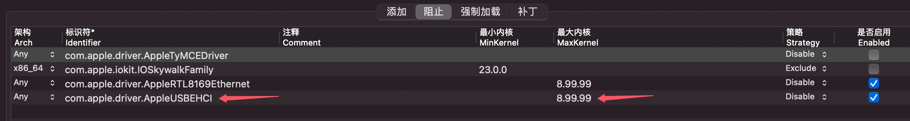
  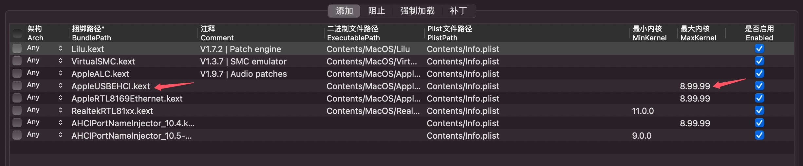

#### UHCI

> UHCI 睡眠唤醒正常，只需要修复控制器被识别为扩展槽的问题即可，根因是 Tiger 原生不支持 ICH10。在 DSDT 里加入 fake id 代码即可。

- 在 OpenCore 的 Kernel Patch 下添加如下条目以实现 Mac OS X 版本区分 (10.4->Darw08，其他->Darwin)，MaxKernel 设置 8.99.99 以避免影响其他系统
  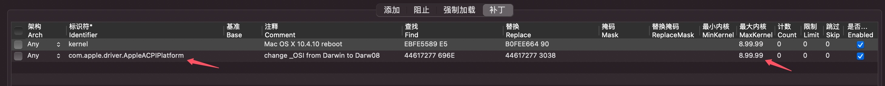

- 在 DSDT 的 PCI0 下加入如下仿冒代码 (以 UHC1 为例，UHC2-UHC6 同理)
  ```
  Device (UHC1)
  {
      Name (_ADR, 0x001D0000)
      Method (_S3D, 0, NotSerialized)
      {
          If (LEqual (OSFL, 0x02))
          {
              Return (0x02)
          }

          Return (0x03)
      }

      Name (_PRW, Package (0x02)
      {
          0x03, 
          0x03
      })
      Method (_DSM, 4, NotSerialized)
      {
          If (LEqual (Arg2, Zero))
          {
              Return (Buffer (One)
              {
                  0x03
              })
          }

          If (_OSI ("Darw08"))
          {
              Return (Package (0x04)
              {
                  "device-id", 
                  Buffer (0x04)
                  {
                      0x30, 0x28, 0x00, 0x00
                  }, 

                  "built-in", 
                  Buffer (One)
                  {
                      0x00
                  }
              })
          }

          Return (Package (0x00) {})
      }
  }

  ```
> 至此，Tiger 下的 USB 已修复完成，KVM/HUB 下的键鼠唤醒已恢复正常。所有 USB 控制器均显示为内建控制器，唤醒后不会弹出U盘。

### 10.5-10.7
- 在 DSDT 的 PCI0 下中加入如下代码以修复 KVM/HUB 下的键鼠唤醒以及唤醒后 U 盘弹出的问题 (以 EHC1 为例，EHC2 同理，且 10.5-10.7 不存在内建问题)
  ```
  Device (EHC1)
  {
      Name (_ADR, 0x001D0007)
      Method (_S3D, 0, NotSerialized)
      {
          If (LEqual (OSFL, 0x02))
          {
              Return (0x02)
          }

          Return (0x03)
      }

      Name (_PRW, Package (0x02)
      {
          0x0D, 
          0x03
      })
      OperationRegion (PWRC, PCI_Config, 0x52, 0x2F)
      Field (PWRC, ByteAcc, NoLock, Preserve)
      {
              ,   11, 
          PMES,   5, 
              Offset (0x2E), 
          WRTA,   1
      }
  }
  ```
> 至此，10.4 以及 10.5-10.7 用完全不同的方法修复了 USB 相关问题且互相不冲突。切换系统不需要更换 EFI。

## 睡眠唤醒

> 10.4 和 10.5-10.7 的睡眠修复方式完全不同，但是不会互相冲突，一个 EFI 完美兼容 4 个 Mac OS X 版本。

### 10.4
#### 睡眠
> 和显卡 VBIOS 高度相关。笔者测试得知 NVIDIA GeForce 7300 GT， Nvidia Quadra FX 4500 以及 Nvidia Quadra FX 5600 都能睡眠，但是 NVIDIA GeForce 7600 GT 却不行 (10.4 睡眠成功的前提是 BIOS 关闭火线接口)
#### 唤醒
> 按照 USB 章节操作即可

### 10.5-10.7
> 10.5-10.7 的睡眠唤醒在不修复的情况下问题比 10.4 严重得多，唤醒会变成重启，修复方案如下。

- 在 DSDT 第一层的 Scope (\\) 后面加上 PTS 方法
  ```
  Method (_PTS, 1, NotSerialized)
  {
      Or (Arg0, 0xF0, Local0)
      Store (Local0, DBG1)
      OSTP ()
      If (LEqual (Arg0, One)) {}
      If (LEqual (Arg0, 0x03)) {}
      If (LEqual (Arg0, 0x05))
      {
          Store (One, \_SB.PCI0.LPCB.AG3E)
          Store (Zero, SLPE)
          Sleep (0x10)
      }
      Else
      {
          Store (Zero, \_SB.PCI0.LPCB.AG3E)
      }

      If (LEqual (Arg0, 0x04))
      {
          If (LNot (PICF))
          {
              Sleep (0x64)
          }
      }
  }
  ```

- 在 LPCB 末尾加入如下代码
  ```
  OperationRegion (LPC0, PCI_Config, 0xA4, 0x02)
  Field (LPC0, ByteAcc, NoLock, Preserve)
  {
      AG3E,   1
  }
  ```
- 在整个 DSDT 第一层的末尾加入如下代码
  ```
  Field (PMRS, ByteAcc, NoLock, Preserve)
  {
          ,  4, 
      SLPE,  1
  }
  ```
> 至此，10.4-10.7 的睡眠唤醒完全修复，唤醒也不会变成重启了。

## EC 修复
- 在 DSDT 中的 LPCB 下加入如下代码即可修复 EC (别忘了 Darw08)
  ```
  Device (EC)
  {
      Name (_HID, "ACID0001")
      Method (_STA, 0, NotSerialized)
      {
          If (LOr (_OSI ("Darwin"), _OSI ("Darw08")))
          {
              Return (0x0F)
          }
          Else
          {
              Return (Zero)
          }
      }
  }
  ```

## 每次重启 / 关机时都会重置 BIOS

- 在 OpenCore 下加入如下设置
  - Kernel->Quirks->DisableRtcChecksum: YES
    

## 内置硬盘显示为外置

- 在 OpenCore 下加入如下设置
  - Kernel->Quirks->ExternalDiskIcons: YES
    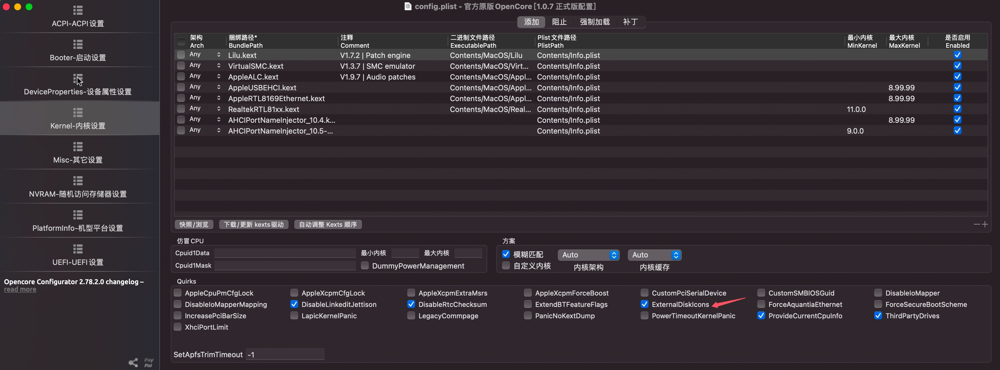

## 10.6/10.7 下开启 SSD Trim

- 在 OpenCore 下加入如下设置
  - Kernel->Quirks->ThirdPartyDrives: YES
    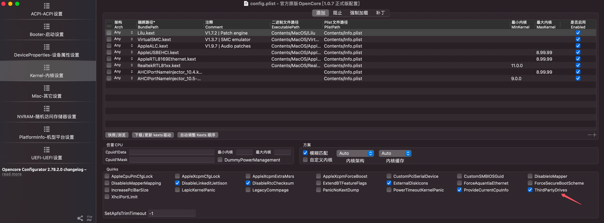

## 重启不断电

> 10.4 和 10.5-10.7 的重启修复方式完全不同，但是不会互相冲突，一个 EFI 完美兼容 4 个 Mac OS X 版本。

### 10.4

- 在 OpenCore 的 Kernel Patch 下添加如图条目并设置 MaxKernel 为 8.99.99 以避免影响其他系统
  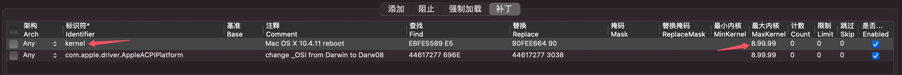

### 10.5-10.7

- 在 OpenCore 下加入如下设置
  - ACPI->Quirks->FadtEnableReset: YES
    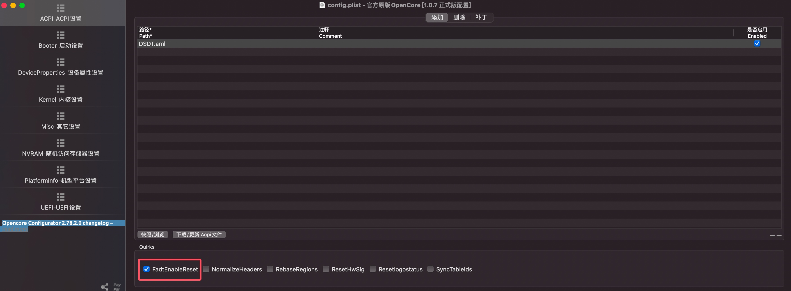

> 至此 10.4-10.7 的重启卡住问题已修复完成。

### AppleLPC 加载

> 对于笔者这台 P45 来说，10.5-10.7 原生加载了 AppleLPC，但是 10.4 不支持 ICH10，所以我们只需要在 DSDT 中给 10.4 仿冒支持的 device id 即可完成 10.4 下的 AppleLPC 加载 (依旧使用 Darw08 分流)。
- 在 DSDT 中的 LPCB 结尾处加入 _DSM 方法如下
  ```
  Method (_DSM, 4, NotSerialized)
  {
      If (_OSI ("Darw08"))
      {
          If (LEqual (Arg2, Zero))
          {
              Return (Buffer (One)
              {
                  0x03
              })
          }

          Return (Package (0x08)
          {
              "device-id", 
              Buffer (0x04)
              {
                  0xB9, 0x27, 0x00, 0x00
              }, 

              "IOName", 
              Buffer (0x0D)
              {
                  "pci8086,27b9"
              }, 

              "name", 
              Buffer (0x0D)
              {
                  "pci8086,27b9"
              }, 

              "compatible", 
              Buffer (0x0D)
              {
                  "pci8086,27b9"
              }
          })
      }

      Return (Buffer (One)
      {
          0x00
      })
  }
  ```

## SATA 控制器重命名

> 因为 Tiger 不支持 ICH10，所以系统信息的 SATA (串行 ATA) 处显示的是 Generic AHCI (null)，而 10.5-10.7 中也因为无法识别第三方 SATA (JMicron JMB363) 而显示 Unknown AHCI Standard Controller，我们有很简单的方法修正名称，方案如下。

- 加入笔者提供的 AHCIPortNameInjector\_10.4.kext (MaxKernel 8.99.99) 以及 AHCIPortNameInjector\_10.5-10.7.kext (MinKernel 9.0.0)，如图
  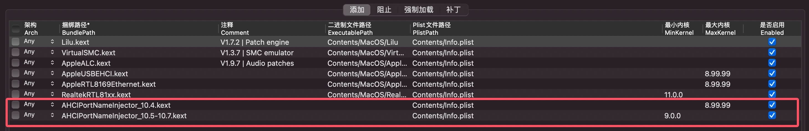

> 至此，SATA 控制器名称已修复，Intel AHCI 名称设置为 Intel ICH10 AHCI，JMB363 AHCI 名称设置为 JMicron JMB363 AHCI。

## Tiger 下不显示二级缓存信息
- 在 OpenCore 下加入如下设置即可 (请使用 OpenCore 1.0.8 版本，里面有笔者的提交，修复了一个 bug)
  - Kernel->Quirks->ProvideCurrentCpuInfo: YES
    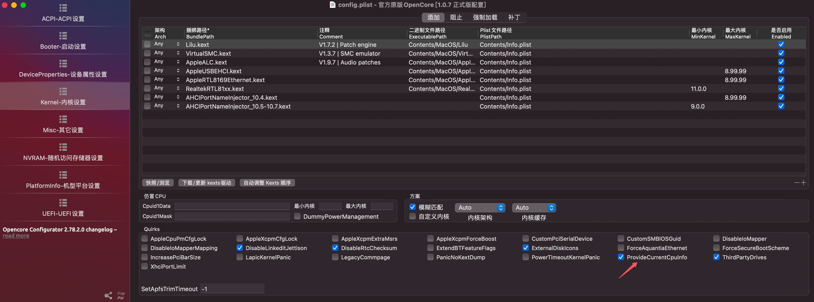
> 简单说一下笔者修复的那个 bug 吧，挺可爱的一个 bug。就是源码中用一个数组来存储缓存信息，但是该数组没初始化。因为新 CPU 都有三缓，所以都会覆盖没问题。但是老 CPU，没有三缓，三缓值就无法被新值覆盖而代入初始垃圾值，于是笔者得到了一台 "拥有 16EB L3 Cache 的 Mac OS X Tiger 计算机😂"，很好修复但挺有趣的 bug😂。

## Lion 下关于本机不显示年份信息

> macOS 关于本机的年份是通过 API 返回的，Mac OS X Lion 系统由于年代久远，已无法正常访问 API 网站，所以我们要手动编辑本地文件以添加年份。

### 确定原生年份信息

#### Mac Pro 1,1 和 Mac Pro 2,1

> 这两个机型的关于本机本身就是是没有年份信息的 (包括白苹果也没有)，但是笔者认为影响美观，所以笔者将其自定义为 Mac Pro（2007 年初）。

#### 其他机型

- 在正常工作的现代操作系统上运行如下命令以获取本应显示的年份信息 (cc=xxx，xxx 为所选机型序列号后三位，10.8 以前参数为序列号后三位，10.8 开始参数为序列号后四位。10.11 以及更早系统访问的 API 有语言参数，10.12 开始没有了，所以老 OS X 版本关于本机的年份是系统语言，新版是英文)

    ```
    curl -s "https://support-sp.apple.com/sp/product?cc=UPZ&lang=zh-Hans_CN" | sed -n 's/.*<configCode>\(.*\)<\/configCode>.*/\1/p'
    ```

- 记录返回值，如 Mac Pro (2007 年初) (这只是模拟结果，上文说了，笔者的 Mac Pro 2,1 机型没有年份信息，所以没有返回值，笔者只是介绍一下正常的获取方法)

- 打开 SMBIOS 年份修复文件夹中的的 plist 文件，修改序列号后三位，语言，机型三个信息。修改好的类似下图
  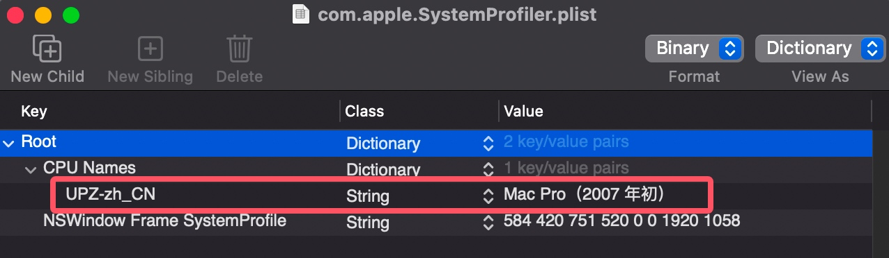

- 将改好的 plist 文件覆盖到 \~/Library/Preferences 并重启，你会发现 Mac OS X Lion 的关于本机年份恢复了

## 10.4/10.5 启动无法绘制 Apple Logo 而回退到类似 -v 的模式

- 在 OpenCore 下加入如下设置
  - UEFI->Output->UgaPassThrough: YES
    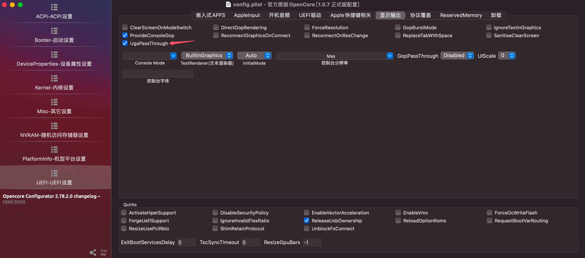

# 引导器截图

## OpenCore (请允许我使用 AI 制作 4K OC Menu 图，OpenDuet 环境下 F10 截图，效果实在太差了)
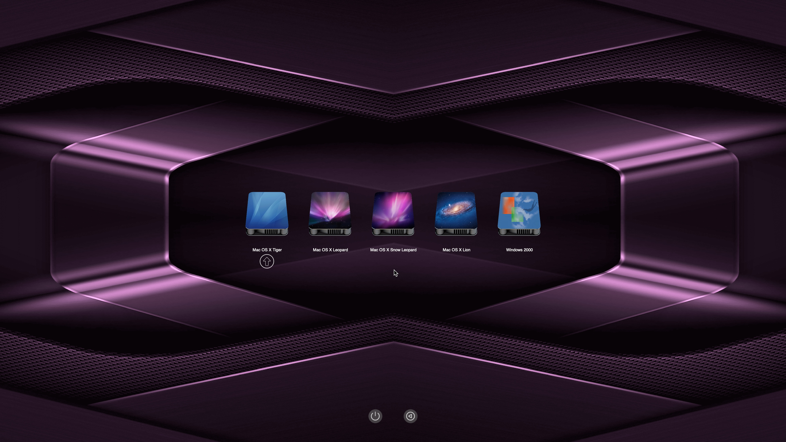

# 系统桌面截图


